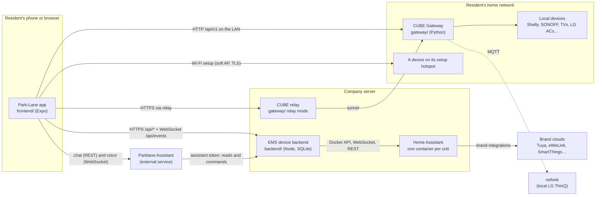
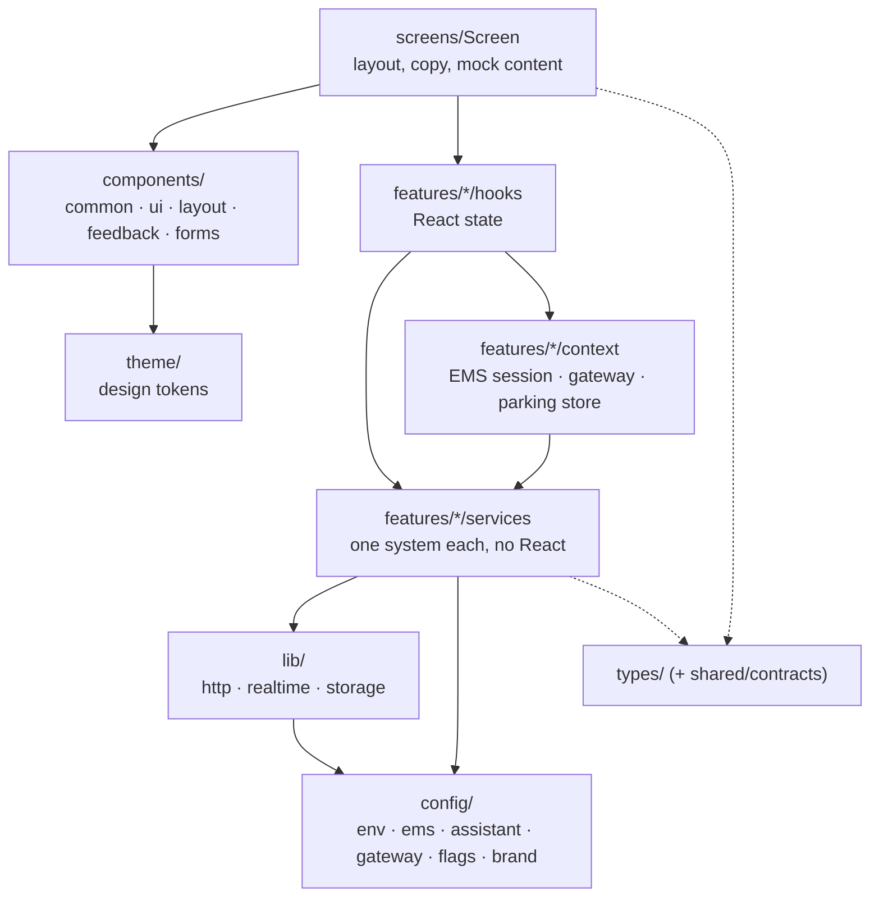
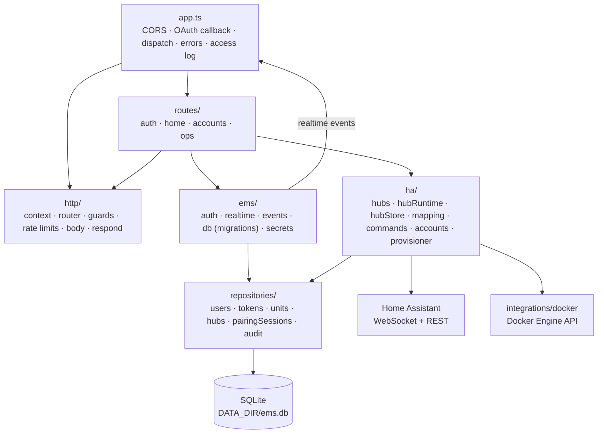
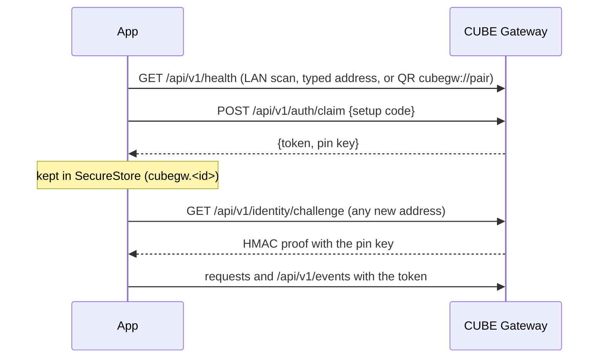
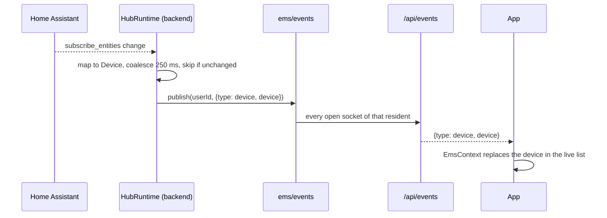

# Architecture

Park-Lane is a resident app for a compound: home, parking, visitors, maintenance, community and a smart home. The smart home has two independent paths, and an external AI assistant can act on it too.

## The system



- **EMS device backend** (`backend/`): EMS accounts, and each resident's home through their unit's own Home Assistant, which reaches the brands' clouds. It keeps every unit's Home Assistant token and runs only allow-listed commands.
- **CUBE Gateway** (`gateway/`): a box in the home for devices that work locally, paired with the phone by a setup code; reachable on the LAN, over Tailscale or through the company's relay. It never talks to the backend; the app merges the two device lists.
- **Parklane Assistant**: an external text and voice assistant. The app gives it a short-lived assistant token, with which it reads the home and sends commands. Every command is audited, and it can never unlock a door.
- **Setup hotspots**: new Shelly, SONOFF and LG devices are given the home Wi-Fi straight from the phone, on their own setup network.
- **Parking** is a demo that runs entirely on the device (see [PARKING_DEMO.md](PARKING_DEMO.md)).

## The app



Arrows point from the importer to what it imports. Lower layers never import higher ones: services do not import components, components do not import screens, and no screen imports another screen.

- **Providers** (`App.tsx`): SafeArea, Theme, App, EMS, Gateway, ParkingDemo, then the navigator once fonts load. The EMS, gateway and parking providers start at launch.
- **Navigation**: one native stack (`navigation/AppNavigator.tsx`). On web, the parking screens and the visitor pass have addresses (`/parking/...`, `/pass/:invite`), so a refresh or a shared link opens them directly.
- **Device classes**: the Figma layouts are the phone layouts. Wider screens reflow through `useScreenLayout()`, `ResponsiveColumns` and `ResponsiveGrid`, and the bottom bar becomes a side rail.

### Talking to systems

| System | Client | Transport | Auth | Errors |
|---|---|---|---|---|
| EMS backend | `features/ems/services/emsHttp.ts` `call()` | `lib/http` fetch core; `{ ok, data }` envelope; reads retried once on a network failure | session bearer token, held in memory, stored in SecureStore / the tab | `EmsError(code)` |
| EMS realtime | `features/ems/services/realtime.ts` | `lib/realtime/ReconnectingSocket`, `/api/events` | first message `{ type: 'auth', token }` | `onRefused` signs out |
| CUBE gateway | `features/gateway/services/gatewayHttp.ts` `gatewayCall()` | fetch core; envelope with a `recovery` hint | per-gateway token, sent only to an address that passed the HMAC identity check | `GatewayError(code, recovery)` |
| Gateway realtime | `features/gateway/services/realtime.ts` | `ReconnectingSocket`, `/api/v1/events`, can move to another address | first message auth | `onRefused` drops the token |
| Parklane Assistant | `features/assistant/services/assistantApi.ts`, `realtimeClient.ts` | fetch core; WebSocket with PCM audio | resident id (demo) or guest; the EMS assistant token in the body | `AssistantApiError(kind)` |
| Device on its hotspot | `features/provisioning/services/deviceHttp.ts` | fetch core, plain HTTP | none | `DeviceHttpError(kind)` |
| LG appliance | `features/lg/services/lgSetupService.ts` | TLS over TCP (react-native-tcp-socket) | none | `LgSetupError` |

Every HTTP client uses `timedFetch()` from `lib/http/request.ts` (timeout, cancel, a read step inside the timeout) and keeps its own wording. `npm run check:transport` pins each client's behaviour.

## The backend



- **Routing** is an ordered list of route groups (`http/router.ts`). A group checks the caller before the method, so a path it owns answers 401 for any method without a token, and a method it does not take falls through to 404 (never 405). `test/routing.test.ts` pins this.
- **Guards**: `requireUser(req, kinds)` (session, or session and assistant tokens for home reads and commands), `authorizeApiKey` for operations.
- **Live state is in memory**: one `HubRuntime` per hub keeps the unit's devices current from Home Assistant's own pushes and fans out changes to that unit's residents over `/api/events`. Rate-limit windows and the event bus are in memory too, **so the backend must run as one process**.
- **Data**: SQLite (`node:sqlite`) in `DATA_DIR`. Tokens are stored as hashes. Hub tokens and passwords are sealed with `EMS_ENCRYPTION_KEY`. Each unit's Home Assistant `/config` folder lives under `DATA_DIR/ha`.
- **Provisioning a unit** (`ha/provisioner.ts`): create the container on a private Docker network, onboard Home Assistant, store the address and sealed token, connect.

## Signing in

```mermaid
sequenceDiagram
  autonumber
  participant App
  participant Backend as EMS backend
  participant HA as Unit's Home Assistant
  participant Assistant as Parklane Assistant

  App->>Backend: POST /api/auth/login {email, password}
  Backend-->>App: {user, token} (session, 30 days)
  Note over App: token in SecureStore (ems.session), web: the tab
  App->>Backend: GET /api/home (Bearer session)
  Backend->>HA: (already connected) unit's rooms and devices
  Backend-->>App: {unit, hub, rooms, deviceCount}
  App->>Backend: WebSocket /api/events, {type: auth, token}
  Backend-->>App: {type: ready}, then device / rooms / hub_status / accounts events
  App->>Backend: POST /api/auth/assistant-token
  Backend-->>App: {token, expiresAt} (assistant, ≤ 12 h, ends with the session)
  App->>Assistant: chat or voice, with the assistant token
  Assistant->>Backend: GET /api/devices, POST /api/devices/:id/commands (Bearer assistant)
  Note over Backend: audited; lock.unlock refused
```

The app's own Login screen is not wired to a backend yet: it opens the app for anyone. The EMS session above is a separate sign-in, in My Devices. Logging out of the app does not end it (`hooks/useScreenMenu.ts`, `TODO(auth)`).

### Pairing a CUBE Gateway



## Realtime



When the connection drops, the app reconnects with exponential back-off (1 s up to 30 s, jittered). It reconnects at once when the app returns to the foreground.

## Configuration and builds

- App settings come from `EXPO_PUBLIC_*` variables, all read in `frontend/src/config/env.ts`, from `.env.local` in development and `eas.json` per build profile. They are built into the app, so they hold no secrets.
- `EXPO_PUBLIC_DEMO_TOOLS` hides the parking demo's tools when set to `0`, `false` or `off`.
- App builds run on EAS (the "App build (EAS)" workflow), in `frontend/`. The web build is hosted on Vercel, with its root directory set to `frontend`.
- The backend deploys as one Docker container (`./scripts/dev.sh server` on the server, see [production.md](production.md)).
- CI (`.github/workflows/ci.yml`) typechecks, lints and tests the app and the backend on every pull request. The gateway has its own workflow.
