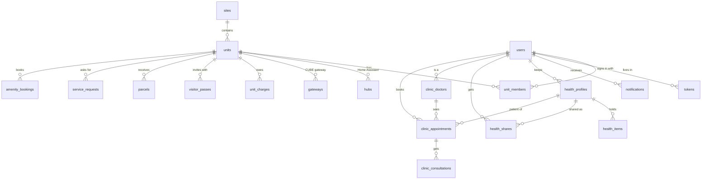

# Database schema

The backend keeps all of its data in **one SQLite database**: the file `ems.db` in `DATA_DIR` (on the server,
inside `PARKLANE_DATA`, for example `/srv/parklane/data/ems.db`). Only
[`backend/src/ems/db.ts`](../backend/src/ems/db.ts) opens it, with Node's built-in `node:sqlite`. It runs with
WAL, foreign keys on, and a 3-second busy timeout.

This file describes the schema at **migration 20** (80 tables), built from the code on
2026-11-10 (branch `feature/real-backend`). Parking and the time series were still being written then, so those
sections may change.

## Contents

- [One database for the whole app](#one-database-for-the-whole-app)
- [How the clinic fits in](#how-the-clinic-fits-in)
- [What is not in the database](#what-is-not-in-the-database)
- [Conventions](#conventions)
- [Changing the schema](#changing-the-schema)
- [Main relationships](#main-relationships)
- [Table reference](#table-reference)

## One database for the whole app

Every feature lives in the same file and uses the same accounts (`users`) and apartments (`units`): sign-in,
smart home, Health Passport, the clinic, My Unit and Bills, visitors, deliveries, requests, community, amenities,
parking and the BMS readings. There are no separate databases per feature. One backup of `DATA_DIR` plus the
encryption key covers all of them.

| Area | Tables |
|---|---|
| [Accounts and sign-in](#accounts-and-sign-in) | `users`, `tokens` |
| [Sites and apartments](#sites-and-apartments) | `sites`, `site_settings`, `units`, `unit_members`, `unit_invites`, `reference_counters` |
| [Smart home and gateways](#smart-home-and-gateways) | `hubs`, `pairing_sessions`, `audit_log`, `gateways`, `gateway_signing_key`, `gateway_containers` |
| [Inbox and management](#inbox-and-management) | `notifications`, `notification_prefs`, `admin_audit` |
| [Health Passport](#health-passport) | `health_consents`, `health_profiles`, `health_items`, `health_documents`, `health_summaries`, `health_shares` |
| [Clinic](#clinic) | `clinic_specialties`, `clinic_doctors`, `clinic_schedules`, `clinic_time_off`, `clinic_appointments`, `clinic_consultations`, `clinic_transcript_segments`, `clinic_addenda`, `clinic_history_summaries`, `clinic_spoken_summaries`, `clinic_audit` |
| [My Unit and Bills](#my-unit-and-bills) | `unit_contracts`, `unit_charges`, `unit_payments`, `meter_readings`, `unit_documents` |
| [Visitors and deliveries](#visitors-and-deliveries) | `visitor_passes`, `visitor_entries`, `parcels` |
| [Maintenance, housekeeping and moving](#maintenance-housekeeping-and-moving) | `technicians`, `service_categories`, `service_requests`, `service_request_events`, `service_request_photos` |
| [Community](#community) | `announcements`, `community_events`, `event_rsvps`, `polls`, `poll_options`, `poll_votes`, `feedback` |
| [Amenities](#amenities) | `amenities`, `amenity_bookings` |
| [Parking](#parking) | 21 tables, `parking_*` |
| [Time series (BMS and energy)](#time-series-bms-and-energy) | `bms_readings`, `unit_energy` |
| [Internal](#internal) | `schema_version` |

## How the clinic fits in

The clinic is **fully part of the app database**, not a separate system:

- **One login.** Doctors and clinic desk staff are ordinary rows in `users` (`role` `doctor` or
  `clinic_staff`). A doctor's profile, `clinic_doctors`, points to that account.
- **The patient is a Health Passport record.** `clinic_appointments.patient_profile_id` and
  `clinic_consultations.patient_profile_id` point to `health_profiles`. Name, sex and birth date are also copied
  into the appointment, so the visit still reads correctly if the record is deleted (the link then becomes empty).
- **Bookings come from app accounts.** `clinic_appointments.booked_by` points to `users`. A resident books for
  their own record, a family member's, or one shared with them for editing.
- **Finished visits go back into the record.** When a doctor finalizes a consultation, it is copied into
  `health_items` with `source = consultation:<id>`.
- **Deleting an account** deletes the person's own health records
  ([`accountDeletion.ts`](../backend/src/repositories/accountDeletion.ts)). If they booked clinic visits, their
  `users` row stays as a placeholder ("Deleted account", no email or password) so the clinic's history stays whole.

## What is not in the database

| What | Where |
|---|---|
| Uploaded files: health documents and summary audio, unit documents, request photos | Encrypted files in `DATA_DIR/health/files`, `DATA_DIR/units/files`, `DATA_DIR/requests/photos`. The tables keep only the file names |
| Doctor photos | `DATA_DIR/clinic/photos` |
| The encryption key | `EMS_ENCRYPTION_KEY` in `backend/.env`, or `DATA_DIR/ems.key` when it is not set. Without it, sealed columns and files can't be read |
| Each apartment's smart home data | That apartment's Home Assistant container, with its own storage |
| Each CUBE gateway's data, and the relay's | Their own SQLite files in their Docker volumes (`gateway/`) |
| LG appliances (ReThink) | ReThink's own data folder |

## Conventions

- **Ids** are text, mostly random UUIDs. The audit tables (`admin_audit`, `audit_log`, `clinic_audit`) count up
  instead.
- **Times** are ISO 8601 text in UTC (`2026-11-10T19:22:20.767Z`). `tokens`, `unit_invites` and
  `pairing_sessions` store milliseconds since 1970 instead. Calendar dates are `YYYY-MM-DD`.
- **Yes/no** values are `0` or `1`.
- **Sealed** values are encrypted (AES-256-GCM) with the backend's key: columns ending in `_sealed`, and the fields
  each table's description names. The backend can read them; a copy of the database file alone cannot.
- **Hashed** values (`password_hash`, `token_hash`, `code_hash`, `secret_hash`) can only be compared, never read
  back.
- **JSON** is stored as text (`site_settings.settings`, `health_items.data`, parking's `data`).
- Allowed values are checked by the database where the notes below list them, and in code everywhere else.

## Changing the schema

1. Add a new migration at the end of `MIGRATIONS` in [`backend/src/ems/db.ts`](../backend/src/ems/db.ts).
   **Never edit a migration that has shipped.**
2. On start, the backend runs every migration it hasn't run yet, each in a transaction, and stores the count in
   `schema_version`. An older backend on a newer database skips the migrations it doesn't know.
3. Prefer adding tables and optional columns. Older code ignores them, so going back to an earlier version stays
   possible.
4. Update this file.

## Main relationships

The core of the schema: accounts, apartments, health and the clinic, and the main things an apartment owns.
Every line is a foreign key from the table on the "many" side.

## Table reference

"Required" means the column can't be empty. "→" is a foreign key to another table.

### Accounts and sign-in

#### `users`

Every account that can sign in: residents, building admins, doctors, clinic desk staff and gate staff. `role` is `resident`, `admin`, `doctor`, `clinic_staff` or `security`; the code checks it ([shared/contracts/auth.ts](../shared/contracts/auth.ts)), not the database. `must_change_password` is set on accounts an admin created or reset.

| Column | Type | Required | Default | Notes |
|---|---|---|---|---|
| `id` | TEXT | yes |  | key |
| `email` | TEXT | yes |  | unique |
| `name` | TEXT | yes |  |  |
| `password_hash` | TEXT | yes |  |  |
| `created_at` | TEXT | yes |  |  |
| `role` | TEXT | yes | `'resident'` |  |
| `must_change_password` | INTEGER | yes | `0` |  |

#### `tokens`

Sign-in tokens the backend issues, stored only as hashes. `kind`: `session` (the app) or `assistant` (the Parklane Assistant). `parent_hash` links a token to the one it came from; revoking a token revokes its children.

| Column | Type | Required | Default | Notes |
|---|---|---|---|---|
| `token_hash` | TEXT | yes |  | key |
| `user_id` | TEXT | yes |  | → `users.id`, on delete cascade |
| `kind` | TEXT | yes |  |  |
| `client_id` | TEXT |  |  |  |
| `expires_at` | INTEGER | yes |  |  |
| `created_at` | INTEGER | yes |  |  |
| `revoked_at` | INTEGER |  |  |  |
| `parent_hash` | TEXT |  |  |  |

### Sites and apartments

#### `sites`

A compound. Everything building-wide belongs to one (announcements, amenities, parking, BMS readings). `kind = demo` sites are the only ones the data generator writes to. `series_key` is the short number the time-series tables use instead of the text id.

| Column | Type | Required | Default | Notes |
|---|---|---|---|---|
| `id` | TEXT | yes |  | key |
| `name` | TEXT | yes |  |  |
| `timezone` | TEXT | yes |  |  |
| `kind` | TEXT | yes |  | `real`, `demo` |
| `series_key` | INTEGER | yes |  | unique |
| `created_at` | TEXT | yes |  |  |

#### `site_settings`

Rules management can change per site (emergency number, visiting hours, booking windows…), as JSON checked by `ems/siteSettings.ts`. Missing keys take the defaults there.

| Column | Type | Required | Default | Notes |
|---|---|---|---|---|
| `site_id` | TEXT | yes |  | key; → `sites.id`, on delete cascade |
| `settings` | TEXT | yes |  |  |
| `updated_at` | TEXT | yes |  |  |

#### `units`

An apartment: its site, tower, floor, number, type and size. The newer columns can be empty for apartments made before them.

| Column | Type | Required | Default | Notes |
|---|---|---|---|---|
| `id` | TEXT | yes |  | key |
| `name` | TEXT | yes |  |  |
| `building` | TEXT |  |  |  |
| `created_at` | TEXT | yes |  |  |
| `site_id` | TEXT |  |  | → `sites.id` |
| `tower` | TEXT |  |  |  |
| `floor` | INTEGER |  |  |  |
| `number` | TEXT |  |  |  |
| `unit_type` | TEXT |  |  |  |
| `bedrooms` | INTEGER |  |  |  |
| `bathrooms` | INTEGER |  |  |  |
| `area_m2` | REAL |  |  |  |
| `parking_bay` | TEXT |  |  |  |
| `handover_status` | TEXT |  |  |  |
| `series_key` | INTEGER |  |  | unique |

#### `unit_members`

Which accounts live in which apartment. `role`: `owner` or `member`. One apartment per resident for now.

| Column | Type | Required | Default | Notes |
|---|---|---|---|---|
| `unit_id` | TEXT | yes |  | key (part); → `units.id`, on delete cascade |
| `user_id` | TEXT | yes |  | key (part); → `users.id`, on delete cascade; unique |
| `role` | TEXT | yes |  |  |
| `created_at` | TEXT | yes |  |  |

Triggers: `health_shares_end_on_leave`, `health_shares_end_on_move`.

#### `unit_invites`

Codes an owner makes so another account can join their apartment. Stored hashed, single use, valid for a day.

| Column | Type | Required | Default | Notes |
|---|---|---|---|---|
| `code_hash` | TEXT | yes |  | key |
| `unit_id` | TEXT | yes |  | → `units.id`, on delete cascade |
| `role` | TEXT | yes |  |  |
| `created_by` | TEXT | yes |  | → `users.id`, on delete cascade |
| `created_at` | INTEGER | yes |  |  |
| `expires_at` | INTEGER | yes |  |  |
| `used_by` | TEXT |  |  |  |
| `used_at` | INTEGER |  |  |  |

#### `reference_counters`

Counters for the references people read and quote (REQ-2026-00124, BK-01001, receipt numbers): one per site, kind and year.

| Column | Type | Required | Default | Notes |
|---|---|---|---|---|
| `site_id` | TEXT | yes |  | key (part) |
| `kind` | TEXT | yes |  | key (part) |
| `year` | INTEGER | yes |  | key (part) |
| `next` | INTEGER | yes |  |  |

### Smart home and gateways

#### `hubs`

The apartment's Home Assistant: a container this server runs (`kind = container`), or a box in the apartment an admin attached (`box`). Its token and admin password are sealed.

| Column | Type | Required | Default | Notes |
|---|---|---|---|---|
| `id` | TEXT | yes |  | key |
| `unit_id` | TEXT | yes |  | → `units.id`, on delete cascade; unique |
| `kind` | TEXT | yes |  |  |
| `base_url` | TEXT |  |  |  |
| `token_sealed` | TEXT |  |  |  |
| `admin_password_sealed` | TEXT |  |  |  |
| `container_name` | TEXT |  |  |  |
| `ha_version` | TEXT |  |  |  |
| `status` | TEXT | yes |  |  |
| `last_seen` | TEXT |  |  |  |
| `last_error` | TEXT |  |  |  |
| `created_at` | TEXT | yes |  |  |
| `updated_at` | TEXT | yes |  |  |

#### `pairing_sessions`

A device pairing in progress on a hub (a Home Assistant setup flow), until it finishes or expires.

| Column | Type | Required | Default | Notes |
|---|---|---|---|---|
| `flow_id` | TEXT | yes |  | key |
| `hub_id` | TEXT | yes |  | → `hubs.id`, on delete cascade |
| `user_id` | TEXT | yes |  | → `users.id`, on delete cascade |
| `handler` | TEXT | yes |  |  |
| `fields` | TEXT |  |  |  |
| `created_at` | INTEGER | yes |  |  |
| `expires_at` | INTEGER | yes |  |  |

#### `audit_log`

Smart home actions: who did what on which hub, and through what (`via`).

| Column | Type | Required | Default | Notes |
|---|---|---|---|---|
| `id` | INTEGER | yes |  | key |
| `user_id` | TEXT |  |  |  |
| `hub_id` | TEXT |  |  |  |
| `action` | TEXT | yes |  |  |
| `target` | TEXT |  |  |  |
| `at` | TEXT | yes |  |  |
| `via` | TEXT |  |  |  |

#### `gateways`

The CUBE gateway serving an apartment (one each). Residents get passes the gateway checks with the backend's public key; the gateway proves itself with its sync secret (`secret_hash`) when it asks which residents are still members.

| Column | Type | Required | Default | Notes |
|---|---|---|---|---|
| `id` | TEXT | yes |  | key |
| `unit_id` | TEXT | yes |  | → `units.id`, on delete cascade; unique |
| `url` | TEXT |  |  |  |
| `secret_hash` | TEXT | yes |  |  |
| `last_sync` | TEXT |  |  |  |
| `created_at` | TEXT | yes |  |  |
| `updated_at` | TEXT | yes |  |  |

#### `gateway_signing_key`

The Ed25519 key that signs gateway passes: one row, the private key sealed.

| Column | Type | Required | Default | Notes |
|---|---|---|---|---|
| `id` | INTEGER | yes |  | key |
| `private_sealed` | TEXT | yes |  |  |
| `public_key` | TEXT | yes |  |  |
| `created_at` | TEXT | yes |  |  |

#### `gateway_containers`

The CUBE gateway container this backend runs for an apartment (`ems/gatewayProvisioner.ts`). It links to the apartment through the `gateways` row with the same id.

| Column | Type | Required | Default | Notes |
|---|---|---|---|---|
| `unit_id` | TEXT | yes |  | key; → `units.id`, on delete cascade |
| `gateway_id` | TEXT | yes |  | unique |
| `container_name` | TEXT | yes |  | unique |
| `port` | INTEGER |  |  | unique |
| `status` | TEXT | yes |  |  |
| `last_error` | TEXT |  |  |  |
| `created_at` | TEXT | yes |  |  |
| `updated_at` | TEXT | yes |  |  |

### Inbox and management

#### `notifications`

The in-app inbox every feature writes to (`ems/notifications.ts`). Each row belongs to one person.

| Column | Type | Required | Default | Notes |
|---|---|---|---|---|
| `id` | TEXT | yes |  | key |
| `user_id` | TEXT | yes |  | → `users.id`, on delete cascade |
| `kind` | TEXT | yes |  |  |
| `title` | TEXT | yes |  |  |
| `body` | TEXT |  |  |  |
| `ref_type` | TEXT |  |  |  |
| `ref_id` | TEXT |  |  |  |
| `created_at` | TEXT | yes |  |  |
| `read_at` | TEXT |  |  |  |

#### `notification_prefs`

Which kinds of notification a person turned off or on.

| Column | Type | Required | Default | Notes |
|---|---|---|---|---|
| `user_id` | TEXT | yes |  | key (part); → `users.id`, on delete cascade |
| `kind` | TEXT | yes |  | key (part) |
| `enabled` | INTEGER | yes |  |  |

#### `admin_audit`

What building management changed, and who (`actor_id`: the admin, or empty for the API key).

| Column | Type | Required | Default | Notes |
|---|---|---|---|---|
| `id` | INTEGER | yes |  | key |
| `actor_id` | TEXT |  |  |  |
| `action` | TEXT | yes |  |  |
| `target_type` | TEXT |  |  |  |
| `target_id` | TEXT |  |  |  |
| `detail` | TEXT |  |  |  |
| `at` | TEXT | yes |  |  |

### Health Passport

#### `health_consents`

Whether the person agreed to how Health Passport uses their data, and when.

| Column | Type | Required | Default | Notes |
|---|---|---|---|---|
| `user_id` | TEXT | yes |  | key; → `users.id`, on delete cascade |
| `given` | INTEGER | yes |  |  |
| `given_at` | TEXT |  |  |  |
| `updated_at` | TEXT | yes |  |  |

#### `health_profiles`

A health record: the account holder's own (`relation = self`) or a family member's. `owner_id` is its keeper.

| Column | Type | Required | Default | Notes |
|---|---|---|---|---|
| `id` | TEXT | yes |  | key |
| `owner_id` | TEXT | yes |  | → `users.id`, on delete cascade |
| `relation` | TEXT | yes |  |  |
| `name` | TEXT | yes |  |  |
| `sex` | TEXT |  |  |  |
| `date_of_birth` | TEXT |  |  |  |
| `blood_type` | TEXT |  |  |  |
| `record_updated_at` | TEXT | yes |  |  |
| `created_at` | TEXT | yes |  |  |

#### `health_items`

One entry in a record: an allergy, a medication, a visit… `data` holds its fields as sealed JSON. `source` is empty when typed in, a document id, or `consultation:<id>` for a visit a clinic doctor finalized.

| Column | Type | Required | Default | Notes |
|---|---|---|---|---|
| `id` | TEXT | yes |  | key |
| `profile_id` | TEXT | yes |  | → `health_profiles.id`, on delete cascade |
| `section` | TEXT | yes |  |  |
| `data` | TEXT | yes |  |  |
| `source` | TEXT |  |  |  |
| `created_at` | TEXT | yes |  |  |
| `updated_at` | TEXT | yes |  |  |

#### `health_documents`

A medical document uploaded to a record, with the text and items read from it. The file itself is encrypted on disk (`DATA_DIR/health/files`).

| Column | Type | Required | Default | Notes |
|---|---|---|---|---|
| `id` | TEXT | yes |  | key |
| `profile_id` | TEXT | yes |  | → `health_profiles.id`, on delete cascade |
| `type` | TEXT | yes |  |  |
| `document_date` | TEXT |  |  |  |
| `uploaded_at` | TEXT | yes |  |  |
| `status` | TEXT | yes |  |  |
| `error_code` | TEXT |  |  |  |
| `pages` | TEXT | yes |  |  |
| `extracted_text` | TEXT |  |  |  |
| `extracted_items` | TEXT |  |  |  |
| `updated_at` | TEXT | yes |  |  |

#### `health_summaries`

A spoken summary of a record, one per profile, language and specialty (`general` without one). The audio is an encrypted file next to the documents.

| Column | Type | Required | Default | Notes |
|---|---|---|---|---|
| `id` | TEXT | yes |  | key |
| `profile_id` | TEXT | yes |  | → `health_profiles.id`, on delete cascade |
| `lang` | TEXT | yes |  |  |
| `specialty` | TEXT | yes |  |  |
| `status` | TEXT | yes |  |  |
| `phase` | TEXT |  |  |  |
| `record_updated_at` | TEXT | yes |  |  |
| `transcript` | TEXT |  |  |  |
| `audio_file` | TEXT |  |  |  |
| `error_code` | TEXT |  |  |  |
| `started_at` | TEXT | yes |  |  |
| `generated_at` | TEXT |  |  |  |
| `failed_at` | TEXT |  |  |  |

Unique together: (`profile_id`, `lang`, `specialty`).

#### `health_shares`

A record its keeper shares with another resident of the same apartment. `access`: `view` or `edit`. Two triggers end every share a resident gave or got when they leave or move out.

| Column | Type | Required | Default | Notes |
|---|---|---|---|---|
| `profile_id` | TEXT | yes |  | key (part); → `health_profiles.id`, on delete cascade |
| `user_id` | TEXT | yes |  | key (part); → `users.id`, on delete cascade |
| `access` | TEXT | yes |  |  |
| `created_at` | TEXT | yes |  |  |
| `updated_at` | TEXT | yes |  |  |

### Clinic

#### `clinic_specialties`

Medical specialties, in English and Arabic.

| Column | Type | Required | Default | Notes |
|---|---|---|---|---|
| `id` | TEXT | yes |  | key |
| `name_en` | TEXT | yes |  |  |
| `name_ar` | TEXT | yes |  |  |
| `created_at` | TEXT | yes |  |  |

#### `clinic_doctors`

A doctor's public profile: names, title and bio in English and Arabic, fee, visit length, languages. **Each doctor signs in with their own app account** (`user_id → users`). Photos are files in `DATA_DIR/clinic/photos`.

| Column | Type | Required | Default | Notes |
|---|---|---|---|---|
| `id` | TEXT | yes |  | key |
| `user_id` | TEXT | yes |  | → `users.id`, on delete cascade; unique |
| `specialty_id` | TEXT | yes |  | → `clinic_specialties.id` |
| `display_name` | TEXT | yes |  |  |
| `display_name_ar` | TEXT |  |  |  |
| `title` | TEXT |  |  |  |
| `title_ar` | TEXT |  |  |  |
| `bio` | TEXT |  |  |  |
| `bio_ar` | TEXT |  |  |  |
| `years_experience` | INTEGER |  |  |  |
| `consultation_minutes` | INTEGER | yes |  |  |
| `fee_egp` | INTEGER |  |  |  |
| `languages` | TEXT |  |  |  |
| `photo` | TEXT |  |  |  |
| `active` | INTEGER | yes | `1` |  |
| `created_at` | TEXT | yes |  |  |
| `updated_at` | TEXT | yes |  |  |

#### `clinic_schedules`

A doctor's weekly hours, in the clinic's time zone. `weekday`: 0 Sunday … 6 Saturday.

| Column | Type | Required | Default | Notes |
|---|---|---|---|---|
| `id` | TEXT | yes |  | key |
| `doctor_id` | TEXT | yes |  | → `clinic_doctors.id`, on delete cascade |
| `weekday` | INTEGER | yes |  |  |
| `start_time` | TEXT | yes |  |  |
| `end_time` | TEXT | yes |  |  |

#### `clinic_time_off`

Time a doctor is away. No slots are offered inside it.

| Column | Type | Required | Default | Notes |
|---|---|---|---|---|
| `id` | TEXT | yes |  | key |
| `doctor_id` | TEXT | yes |  | → `clinic_doctors.id`, on delete cascade |
| `starts_at` | TEXT | yes |  |  |
| `ends_at` | TEXT | yes |  |  |
| `reason` | TEXT |  |  |  |

#### `clinic_appointments`

A booked visit: the doctor, the patient (a Health Passport profile, with name, sex and birth date copied in), who booked it, the consent choices (share history, AI), and every step: check-in, ready, started, completed, cancelled, no-show, rescheduled.

| Column | Type | Required | Default | Notes |
|---|---|---|---|---|
| `id` | TEXT | yes |  | key |
| `doctor_id` | TEXT | yes |  | → `clinic_doctors.id` |
| `patient_profile_id` | TEXT |  |  | → `health_profiles.id`, on delete set null |
| `patient_name` | TEXT | yes |  |  |
| `patient_sex` | TEXT |  |  |  |
| `patient_dob` | TEXT |  |  |  |
| `booked_by` | TEXT | yes |  | → `users.id` |
| `starts_at` | TEXT | yes |  |  |
| `ends_at` | TEXT | yes |  |  |
| `status` | TEXT | yes |  |  |
| `reason` | TEXT |  |  |  |
| `share_history` | INTEGER | yes | `0` |  |
| `share_history_at` | TEXT |  |  |  |
| `ai_consent` | INTEGER | yes | `0` |  |
| `ai_consent_at` | TEXT |  |  |  |
| `ai_consent_by` | TEXT |  |  |  |
| `checked_in_at` | TEXT |  |  |  |
| `checked_in_by` | TEXT |  |  |  |
| `ready_at` | TEXT |  |  |  |
| `started_at` | TEXT |  |  |  |
| `completed_at` | TEXT |  |  |  |
| `cancelled_at` | TEXT |  |  |  |
| `cancelled_by` | TEXT |  |  |  |
| `cancel_reason` | TEXT |  |  |  |
| `no_show_at` | TEXT |  |  |  |
| `rescheduled_from` | TEXT |  |  |  |
| `rescheduled_to` | TEXT |  |  |  |
| `next_notified_at` | TEXT |  |  |  |
| `created_at` | TEXT | yes |  |  |
| `updated_at` | TEXT | yes |  |  |

Unique together: (`patient_profile_id`, `starts_at`) (only some rows); (`doctor_id`, `starts_at`) (only some rows).

#### `clinic_consultations`

The doctor's note for a visit, one per appointment. A draft can be edited (`version` guards against two editors); once final it never changes, and corrections become addenda.

| Column | Type | Required | Default | Notes |
|---|---|---|---|---|
| `id` | TEXT | yes |  | key |
| `appointment_id` | TEXT | yes |  | → `clinic_appointments.id`; unique |
| `doctor_id` | TEXT | yes |  | → `clinic_doctors.id` |
| `patient_profile_id` | TEXT |  |  | → `health_profiles.id`, on delete set null |
| `status` | TEXT | yes |  |  |
| `version` | INTEGER | yes | `1` |  |
| `recording_consent_at` | TEXT |  |  |  |
| `notes` | TEXT |  |  |  |
| `draft` | TEXT |  |  |  |
| `transcript_edited` | TEXT |  |  |  |
| `ai_draft` | TEXT |  |  |  |
| `ai_generated_at` | TEXT |  |  |  |
| `ai_used` | INTEGER | yes | `0` |  |
| `final` | TEXT |  |  |  |
| `finalized_at` | TEXT |  |  |  |
| `finalized_by` | TEXT |  |  | → `users.id` |
| `passport_synced_at` | TEXT |  |  |  |
| `content_purged_at` | TEXT |  |  |  |
| `created_at` | TEXT | yes |  |  |
| `updated_at` | TEXT | yes |  |  |

#### `clinic_transcript_segments`

Speech-to-text, one recorded piece at a time, so an interrupted recording keeps what was already written down. The audio itself is never stored.

| Column | Type | Required | Default | Notes |
|---|---|---|---|---|
| `id` | TEXT | yes |  | key |
| `consultation_id` | TEXT | yes |  | → `clinic_consultations.id`, on delete cascade |
| `seq` | INTEGER | yes |  |  |
| `duration_ms` | INTEGER |  |  |  |
| `language` | TEXT |  |  |  |
| `content` | TEXT | yes |  |  |
| `created_at` | TEXT | yes |  |  |

Unique together: (`consultation_id`, `seq`).

#### `clinic_addenda`

Corrections added to a final consultation, which itself never changes.

| Column | Type | Required | Default | Notes |
|---|---|---|---|---|
| `id` | TEXT | yes |  | key |
| `consultation_id` | TEXT | yes |  | → `clinic_consultations.id` |
| `author_id` | TEXT | yes |  | → `users.id` |
| `text` | TEXT | yes |  |  |
| `created_at` | TEXT | yes |  |  |

#### `clinic_history_summaries`

AI summaries of the patient's history to help with one visit. Never part of the record. Sealed, and deleted once they expire.

| Column | Type | Required | Default | Notes |
|---|---|---|---|---|
| `appointment_id` | TEXT | yes |  | key (part); → `clinic_appointments.id`, on delete cascade |
| `lang` | TEXT | yes |  | key (part) |
| `content` | TEXT | yes |  |  |
| `source_hash` | TEXT | yes |  |  |
| `generated_at` | TEXT | yes |  |  |
| `expires_at` | INTEGER | yes |  |  |

#### `clinic_spoken_summaries`

The spoken handover for a visit ("Listen to summary"): the sealed script, kept until a day after the visit.

| Column | Type | Required | Default | Notes |
|---|---|---|---|---|
| `appointment_id` | TEXT | yes |  | key (part); → `clinic_appointments.id`, on delete cascade |
| `lang` | TEXT | yes |  | key (part) |
| `script` | TEXT | yes |  |  |
| `source_hash` | TEXT | yes |  |  |
| `expires_at` | INTEGER | yes |  |  |

#### `clinic_audit`

Who did what to which record, and when. Ids and action names only, never medical text.

| Column | Type | Required | Default | Notes |
|---|---|---|---|---|
| `id` | INTEGER | yes |  | key |
| `at` | TEXT | yes |  |  |
| `actor_id` | TEXT |  |  |  |
| `actor_role` | TEXT |  |  |  |
| `action` | TEXT | yes |  |  |
| `appointment_id` | TEXT |  |  |  |
| `consultation_id` | TEXT |  |  |  |
| `patient_profile_id` | TEXT |  |  |  |
| `detail` | TEXT |  |  |  |

### My Unit and Bills

Money is whole piastres (EGP × 100). Dates are `YYYY-MM-DD` in the site's time zone.

#### `unit_contracts`

The apartment's sale or lease contract. Finance belongs to the apartment, not to a person, so it outlives any account.

| Column | Type | Required | Default | Notes |
|---|---|---|---|---|
| `id` | TEXT | yes |  | key |
| `unit_id` | TEXT | yes |  | → `units.id`, on delete cascade |
| `kind` | TEXT | yes |  | `sale`, `lease` |
| `price` | INTEGER | yes |  |  |
| `signed_on` | TEXT |  |  |  |
| `handover_on` | TEXT |  |  |  |
| `created_at` | TEXT | yes |  |  |
| `updated_at` | TEXT | yes |  |  |

#### `unit_charges`

What the apartment owes: down payment and installments, service charges, utility bills. `status` is `due` or `void`; paid and partly paid follow from the payments.

| Column | Type | Required | Default | Notes |
|---|---|---|---|---|
| `id` | TEXT | yes |  | key |
| `unit_id` | TEXT | yes |  | → `units.id`, on delete cascade |
| `contract_id` | TEXT |  |  | → `unit_contracts.id`, on delete set null |
| `kind` | TEXT | yes |  | `down_payment`, `installment`, `service_charge`, `electricity`, `water`, `gas`, `other` |
| `title` | TEXT | yes |  |  |
| `period` | TEXT |  |  |  |
| `due_on` | TEXT | yes |  |  |
| `amount` | INTEGER | yes |  |  |
| `status` | TEXT | yes |  | `due`, `void` |
| `reference` | TEXT | yes |  | unique |
| `created_at` | TEXT | yes |  |  |
| `updated_at` | TEXT | yes |  |  |

#### `unit_payments`

Payments building management records (cash, transfer, cheque, card at the office). Never made in the app.

| Column | Type | Required | Default | Notes |
|---|---|---|---|---|
| `id` | TEXT | yes |  | key |
| `unit_id` | TEXT | yes |  | → `units.id`, on delete cascade |
| `charge_id` | TEXT |  |  | → `unit_charges.id`, on delete set null |
| `amount` | INTEGER | yes |  |  |
| `paid_on` | TEXT | yes |  |  |
| `method` | TEXT | yes |  | `cash`, `bank_transfer`, `cheque`, `card_at_office` |
| `receipt_no` | TEXT | yes |  | unique |
| `note` | TEXT |  |  |  |
| `recorded_by` | TEXT |  |  | → `users.id`, on delete set null |
| `created_at` | TEXT | yes |  |  |

#### `meter_readings`

Monthly meter readings, entered by management (`manual`) or later by a live meter (`live`).

| Column | Type | Required | Default | Notes |
|---|---|---|---|---|
| `unit_id` | TEXT | yes |  | key (part); → `units.id`, on delete cascade |
| `meter` | TEXT | yes |  | key (part); `electricity`, `water`, `gas` |
| `period` | TEXT | yes |  | key (part) |
| `value` | REAL | yes |  |  |
| `read_on` | TEXT | yes |  |  |
| `source` | TEXT | yes |  | `manual`, `live` |

#### `unit_documents`

Floor plans and other papers management uploads. The file is encrypted on disk (`DATA_DIR/units/files`).

| Column | Type | Required | Default | Notes |
|---|---|---|---|---|
| `id` | TEXT | yes |  | key |
| `unit_id` | TEXT | yes |  | → `units.id`, on delete cascade |
| `kind` | TEXT | yes |  | `floor_plan`, `contract_scan`, `other` |
| `title` | TEXT | yes |  |  |
| `file` | TEXT | yes |  |  |
| `mime` | TEXT | yes |  |  |
| `size` | INTEGER | yes |  |  |
| `uploaded_by` | TEXT |  |  | → `users.id`, on delete set null |
| `created_at` | TEXT | yes |  |  |

### Visitors and deliveries

#### `visitor_passes`

A visitor pass. The visitor's name and phone are sealed. The QR code holds the pass id and a random token: `token_hash` finds the pass at the gate, `token_sealed` lets the resident show it again.

| Column | Type | Required | Default | Notes |
|---|---|---|---|---|
| `id` | TEXT | yes |  | key |
| `unit_id` | TEXT | yes |  | → `units.id`, on delete cascade |
| `created_by` | TEXT |  |  | → `users.id`, on delete set null |
| `visitor_name` | TEXT | yes |  |  |
| `visitor_phone` | TEXT |  |  |  |
| `plate` | TEXT |  |  |  |
| `guests` | INTEGER | yes |  |  |
| `arrives_at` | TEXT | yes |  |  |
| `valid_from` | TEXT | yes |  |  |
| `valid_to` | TEXT | yes |  |  |
| `uses` | TEXT | yes |  | `single`, `multi` |
| `status` | TEXT | yes |  | `scheduled`, `arrived`, `left`, `revoked` |
| `token_hash` | TEXT | yes |  | unique |
| `token_sealed` | TEXT | yes |  |  |
| `created_at` | TEXT | yes |  |  |
| `updated_at` | TEXT | yes |  |  |
| `revoked_at` | TEXT |  |  |  |

#### `visitor_entries`

Each entry and exit on a pass: which gate, when, and who recorded it.

| Column | Type | Required | Default | Notes |
|---|---|---|---|---|
| `id` | TEXT | yes |  | key |
| `pass_id` | TEXT | yes |  | → `visitor_passes.id`, on delete cascade |
| `kind` | TEXT | yes |  | `entry`, `exit` |
| `gate` | TEXT |  |  |  |
| `at` | TEXT | yes |  |  |
| `by_user` | TEXT |  |  | → `users.id`, on delete set null |

#### `parcels`

Parcels the gate or lobby logs for an apartment, until collected or returned.

| Column | Type | Required | Default | Notes |
|---|---|---|---|---|
| `id` | TEXT | yes |  | key |
| `unit_id` | TEXT | yes |  | → `units.id`, on delete cascade |
| `reference` | TEXT | yes |  | unique |
| `carrier` | TEXT |  |  |  |
| `description` | TEXT |  |  |  |
| `status` | TEXT | yes |  | `waiting`, `collected`, `returned` |
| `received_at` | TEXT | yes |  |  |
| `received_by` | TEXT |  |  | → `users.id`, on delete set null |
| `closed_at` | TEXT |  |  |  |
| `closed_by` | TEXT |  |  | → `users.id`, on delete set null |

### Maintenance, housekeeping and moving

#### `technicians`

The building's technicians and their trades, per site.

| Column | Type | Required | Default | Notes |
|---|---|---|---|---|
| `id` | TEXT | yes |  | key |
| `site_id` | TEXT | yes |  | → `sites.id`, on delete cascade |
| `name` | TEXT | yes |  |  |
| `phone` | TEXT |  |  |  |
| `trades` | TEXT | yes |  |  |
| `active` | INTEGER | yes | `1` |  |
| `created_at` | TEXT | yes |  |  |
| `updated_at` | TEXT | yes |  |  |

#### `service_categories`

The choices for each request kind (maintenance, housekeeping, moving), per site. The migration adds the defaults.

| Column | Type | Required | Default | Notes |
|---|---|---|---|---|
| `site_id` | TEXT | yes |  | key (part); → `sites.id`, on delete cascade |
| `kind` | TEXT | yes |  | key (part); `maintenance`, `housekeeping`, `moving` |
| `id` | TEXT | yes |  | key (part) |
| `title` | TEXT | yes |  |  |
| `sort` | INTEGER | yes |  |  |
| `active` | INTEGER | yes | `1` |  |

#### `service_requests`

A maintenance, housekeeping or moving request. It belongs to the apartment and stays as the building's history. Details are sealed.

| Column | Type | Required | Default | Notes |
|---|---|---|---|---|
| `id` | TEXT | yes |  | key |
| `unit_id` | TEXT | yes |  | → `units.id`, on delete cascade |
| `created_by` | TEXT |  |  | → `users.id`, on delete set null |
| `kind` | TEXT | yes |  | `maintenance`, `housekeeping`, `moving` |
| `category` | TEXT | yes |  |  |
| `title` | TEXT | yes |  |  |
| `details` | TEXT |  |  |  |
| `priority` | TEXT | yes |  | `normal`, `urgent` |
| `preferred_date` | TEXT | yes |  |  |
| `preferred_window` | TEXT | yes |  |  |
| `scheduled_date` | TEXT |  |  |  |
| `scheduled_window` | TEXT |  |  |  |
| `technician_id` | TEXT |  |  | → `technicians.id`, on delete set null |
| `status` | TEXT | yes |  | `submitted`, `assigned`, `in_progress`, `completed`, `cancelled` |
| `reference` | TEXT | yes |  | unique |
| `created_at` | TEXT | yes |  |  |
| `updated_at` | TEXT | yes |  |  |

#### `service_request_events`

A request's history: status changes and comments, from the resident or staff. Comments are sealed.

| Column | Type | Required | Default | Notes |
|---|---|---|---|---|
| `id` | TEXT | yes |  | key |
| `request_id` | TEXT | yes |  | → `service_requests.id`, on delete cascade |
| `kind` | TEXT | yes |  | `status`, `comment` |
| `status` | TEXT |  |  |  |
| `note` | TEXT |  |  |  |
| `by_user` | TEXT |  |  | → `users.id`, on delete set null |
| `by_staff` | INTEGER | yes |  |  |
| `at` | TEXT | yes |  |  |

#### `service_request_photos`

Photos on a request. The files are encrypted on disk (`DATA_DIR/requests/photos`).

| Column | Type | Required | Default | Notes |
|---|---|---|---|---|
| `id` | TEXT | yes |  | key |
| `request_id` | TEXT | yes |  | → `service_requests.id`, on delete cascade |
| `file` | TEXT | yes |  |  |
| `mime` | TEXT | yes |  |  |
| `size` | INTEGER | yes |  |  |
| `created_at` | TEXT | yes |  |  |

### Community

#### `announcements`

Management's notices: `kind` news or alert, `level` info or warning.

| Column | Type | Required | Default | Notes |
|---|---|---|---|---|
| `id` | TEXT | yes |  | key |
| `site_id` | TEXT | yes |  | → `sites.id`, on delete cascade |
| `kind` | TEXT | yes |  | `news`, `alert` |
| `level` | TEXT | yes |  | `info`, `warning` |
| `title` | TEXT | yes |  |  |
| `body` | TEXT | yes |  |  |
| `full_text` | TEXT |  |  |  |
| `picture` | TEXT |  |  |  |
| `published_at` | TEXT | yes |  |  |
| `expires_at` | TEXT |  |  |  |
| `created_by` | TEXT |  |  | → `users.id`, on delete set null |
| `created_at` | TEXT | yes |  |  |
| `updated_at` | TEXT | yes |  |  |

#### `community_events`

Events: times, place, capacity and the RSVP window.

| Column | Type | Required | Default | Notes |
|---|---|---|---|---|
| `id` | TEXT | yes |  | key |
| `site_id` | TEXT | yes |  | → `sites.id`, on delete cascade |
| `title` | TEXT | yes |  |  |
| `description` | TEXT | yes |  |  |
| `starts_at` | TEXT | yes |  |  |
| `ends_at` | TEXT | yes |  |  |
| `venue` | TEXT | yes |  |  |
| `picture` | TEXT |  |  |  |
| `capacity` | INTEGER |  |  |  |
| `rsvp_opens_at` | TEXT |  |  |  |
| `rsvp_until` | TEXT |  |  |  |
| `cancelled_at` | TEXT |  |  |  |
| `created_at` | TEXT | yes |  |  |
| `updated_at` | TEXT | yes |  |  |

#### `event_rsvps`

Who is coming to which event, one row per person.

| Column | Type | Required | Default | Notes |
|---|---|---|---|---|
| `event_id` | TEXT | yes |  | key (part); → `community_events.id`, on delete cascade |
| `user_id` | TEXT | yes |  | key (part); → `users.id`, on delete cascade |
| `created_at` | TEXT | yes |  |  |

#### `polls`

A poll and when it opens and closes.

| Column | Type | Required | Default | Notes |
|---|---|---|---|---|
| `id` | TEXT | yes |  | key |
| `site_id` | TEXT | yes |  | → `sites.id`, on delete cascade |
| `question` | TEXT | yes |  |  |
| `opens_at` | TEXT | yes |  |  |
| `closes_at` | TEXT | yes |  |  |
| `created_at` | TEXT | yes |  |  |
| `updated_at` | TEXT | yes |  |  |

#### `poll_options`

A poll's answers.

| Column | Type | Required | Default | Notes |
|---|---|---|---|---|
| `id` | TEXT | yes |  | key |
| `poll_id` | TEXT | yes |  | → `polls.id`, on delete cascade |
| `label` | TEXT | yes |  |  |
| `picture` | TEXT |  |  |  |
| `sort` | INTEGER | yes |  |  |

#### `poll_votes`

One vote per resident per poll, changeable until the poll closes.

| Column | Type | Required | Default | Notes |
|---|---|---|---|---|
| `poll_id` | TEXT | yes |  | key (part); → `polls.id`, on delete cascade |
| `user_id` | TEXT | yes |  | key (part); → `users.id`, on delete cascade |
| `option_id` | TEXT | yes |  | → `poll_options.id`, on delete cascade |
| `voted_at` | TEXT | yes |  |  |

#### `feedback`

Residents' feedback and management's reply, both sealed.

| Column | Type | Required | Default | Notes |
|---|---|---|---|---|
| `id` | TEXT | yes |  | key |
| `site_id` | TEXT | yes |  | → `sites.id`, on delete cascade |
| `unit_id` | TEXT |  |  | → `units.id`, on delete set null |
| `user_id` | TEXT |  |  | → `users.id`, on delete set null |
| `topic` | TEXT | yes |  | `suggestion`, `concern`, `compliment`, `other` |
| `message` | TEXT | yes |  |  |
| `status` | TEXT | yes |  | `new`, `answered`, `closed` |
| `reply` | TEXT |  |  |  |
| `replied_by` | TEXT |  |  | → `users.id`, on delete set null |
| `replied_at` | TEXT |  |  |  |
| `created_at` | TEXT | yes |  |  |
| `updated_at` | TEXT | yes |  |  |

### Amenities

#### `amenities`

A bookable facility (court, pool, hall…): opening hours, slot length, capacity, whether one booking takes it alone, and the cancel cutoff.

| Column | Type | Required | Default | Notes |
|---|---|---|---|---|
| `id` | TEXT | yes |  | key |
| `site_id` | TEXT | yes |  | → `sites.id`, on delete cascade |
| `title` | TEXT | yes |  |  |
| `location` | TEXT | yes |  |  |
| `opens` | TEXT | yes |  |  |
| `closes` | TEXT | yes |  |  |
| `slot_minutes` | INTEGER | yes |  |  |
| `capacity` | INTEGER | yes |  |  |
| `max_people` | INTEGER | yes |  |  |
| `exclusive` | INTEGER | yes |  |  |
| `categories` | TEXT | yes |  |  |
| `picture` | TEXT |  |  |  |
| `cancel_cutoff_hours` | INTEGER | yes |  |  |
| `active` | INTEGER | yes | `1` |  |
| `sort` | INTEGER | yes | `0` |  |
| `created_at` | TEXT | yes |  |  |
| `updated_at` | TEXT | yes |  |  |

#### `amenity_bookings`

A booking of an amenity by an apartment. The database itself refuses a second booking of an exclusive slot, and a second booking of the same slot by one apartment.

| Column | Type | Required | Default | Notes |
|---|---|---|---|---|
| `id` | TEXT | yes |  | key |
| `amenity_id` | TEXT | yes |  | → `amenities.id`, on delete cascade |
| `unit_id` | TEXT | yes |  | → `units.id`, on delete cascade |
| `user_id` | TEXT |  |  | → `users.id`, on delete set null |
| `starts_at` | TEXT | yes |  |  |
| `ends_at` | TEXT | yes |  |  |
| `people` | INTEGER | yes |  |  |
| `exclusive` | INTEGER | yes |  |  |
| `status` | TEXT | yes |  | `booked`, `cancelled` |
| `reference` | TEXT | yes |  | unique |
| `created_at` | TEXT | yes |  |  |
| `updated_at` | TEXT | yes |  |  |
| `cancelled_at` | TEXT |  |  |  |

Unique together: (`amenity_id`, `starts_at`) (only some rows); (`amenity_id`, `unit_id`, `starts_at`) (only some rows).

### Parking

**Still being built** (plan phase 5): these may change.

Parking is the rules engine the app used to run on the phone, now on the server (`backend/src/parking/`). It keeps each of its collections in its own table, with the same shape: `site_id` and `id` (the key), `version`, and `data`: the record as JSON, sealed where it can name a person or a plate. A few extra columns let the backend load only what a rule needs. Pass and invitation tokens are never stored, only their hashes. Parking's residents and properties are the backend's own users and units.

| Table | What it holds | Extra columns |
|---|---|---|
| `parking_sites` | The parking policy and the booking-reference counter, per site. | `policy`, `reference_serial`, `revision`, `created_at`, `updated_at` |
| `parking_buildings` | Buildings with parking. |  |
| `parking_zones` | Zones inside them. |  |
| `parking_spaces` | Parking spaces. |  |
| `parking_gates` | Parking gates. |  |
| `parking_chargers` | EV chargers. |  |
| `parking_connectors` | The chargers' connectors. |  |
| `parking_residents` | Residents as parking sees them (the backend's own users). |  |
| `parking_properties` | Apartments as parking sees them (the backend's own units). |  |
| `parking_associations` | Which resident belongs to which property. | `resident_id`, `property_id` |
| `parking_vehicles` | Residents' vehicles (plates sealed). | `resident_id` |
| `parking_reservations` | Bookings. | `property_id`, `resident_id`, `status`, `scheduled_end` |
| `parking_invitations` | Guest invitations. Only the invitation token's hash is stored. | `reservation_id`, `invite_hash` |
| `parking_credentials` | Passes for a booking. Only the token's hash is stored. | `reservation_id`, `token_hash` |
| `parking_sessions` | Parking sessions. | `reservation_id` |
| `parking_allocations` | Spaces given to a booking. | `reservation_id` |
| `parking_charging_sessions` | EV charging sessions. | `reservation_id` |
| `parking_scan_events` | Pass scans. | `at`, `reservation_id` |
| `parking_occupancy_events` | A space becoming taken or free. | `at`, `space_id` |
| `parking_notifications` | Messages from parking to residents or staff. | `at`, `audience`, `resident_id`, `reservation_id`, `open` |
| `parking_audit` | Parking's own audit trail. | `at`, `entity_id` |

### Time series (BMS and energy)

**Still being built** (plan phase 6): these may change.

#### `bms_readings`

The building's readings, one row per quarter hour per compound: energy, solar, water, generator, air, network, cameras, elevator, fire panel, gates. `slot` = floor(epoch ms / 900 000). Values are scaled whole numbers (`_x10` = one decimal). `source` 0 = simulated (the generator, demo sites only), 1 = live.

| Column | Type | Required | Default | Notes |
|---|---|---|---|---|
| `site_key` | INTEGER | yes |  | key (part) |
| `slot` | INTEGER | yes |  | key (part) |
| `source` | INTEGER | yes |  |  |
| `kw_x10` | INTEGER | yes |  |  |
| `kwh_x10` | INTEGER | yes |  |  |
| `solar_kw_x10` | INTEGER | yes |  |  |
| `solar_kwh_x10` | INTEGER | yes |  |  |
| `grid_cost` | INTEGER | yes |  |  |
| `solar_saving` | INTEGER | yes |  |  |
| `mdb_volts` | INTEGER | yes |  |  |
| `mdb_amps_x10` | INTEGER | yes |  |  |
| `generator` | INTEGER | yes |  |  |
| `fuel_pct` | INTEGER | yes |  |  |
| `water_tank_pct` | INTEGER | yes |  |  |
| `water_flow_x10` | INTEGER | yes |  |  |
| `pumps` | INTEGER | yes |  |  |
| `co2_ppm` | INTEGER | yes |  |  |
| `temp_x10` | INTEGER | yes |  |  |
| `humidity_pct` | INTEGER | yes |  |  |
| `fans` | INTEGER | yes |  |  |
| `net_down_kbps` | INTEGER | yes |  |  |
| `net_up_kbps` | INTEGER | yes |  |  |
| `ping_ms` | INTEGER | yes |  |  |
| `uptime_x100` | INTEGER | yes |  |  |
| `cameras_online` | INTEGER | yes |  |  |
| `cameras_total` | INTEGER | yes |  |  |
| `elevator_state` | INTEGER | yes |  |  |
| `elevator_floor` | INTEGER | yes |  |  |
| `fire_panel` | INTEGER | yes |  |  |
| `gates` | INTEGER | yes |  |  |
| `fault_code` | INTEGER | yes |  |  |

#### `unit_energy`

An apartment's energy use per quarter hour (lighting, AC, media, other), keyed like `bms_readings`.

| Column | Type | Required | Default | Notes |
|---|---|---|---|---|
| `unit_key` | INTEGER | yes |  | key (part) |
| `slot` | INTEGER | yes |  | key (part) |
| `source` | INTEGER | yes |  |  |
| `total_wh` | INTEGER | yes |  |  |
| `lighting_wh` | INTEGER | yes |  |  |
| `ac_wh` | INTEGER | yes |  |  |
| `media_wh` | INTEGER | yes |  |  |
| `other_wh` | INTEGER | yes |  |  |

### Internal

#### `schema_version`

One row: how many migrations have run.

| Column | Type | Required | Default | Notes |
|---|---|---|---|---|
| `version` | INTEGER | yes |  |  |
